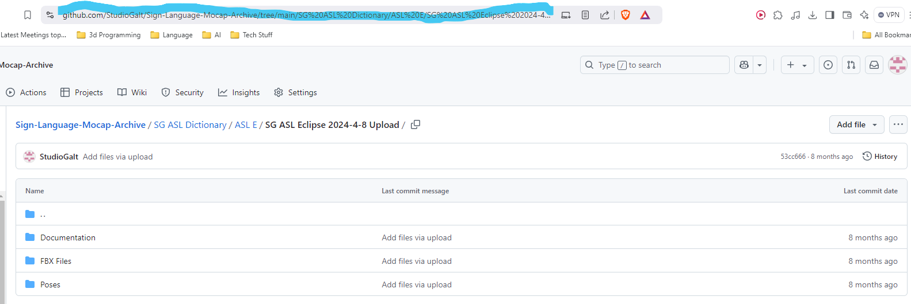
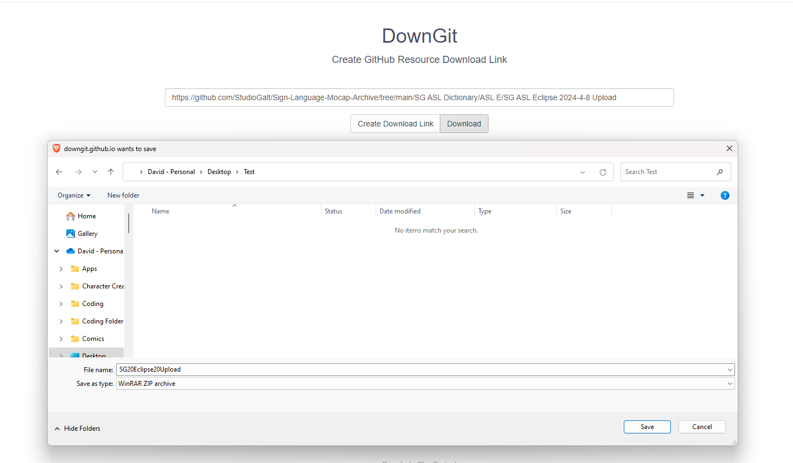
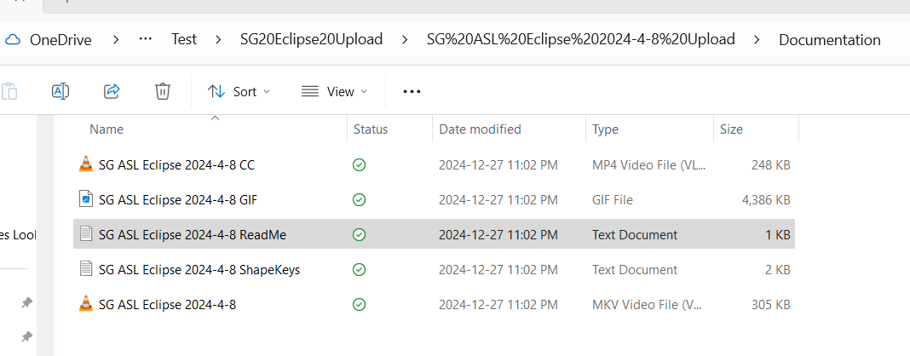

# DownGit Workflow (How to download specific files)

_Converted from the original Word document in this folder._

In your browser, go to the archive <https://github.com/StudioGalt/Sign-Language-Mocap-Archive/tree/main> . Find the file you would like, and copy the address.

Then paste that into <https://downgit.github.io/#/home>

Save and unzip.

