# Maya Workflow

_Converted from the original Word document in this folder._

Open Maya

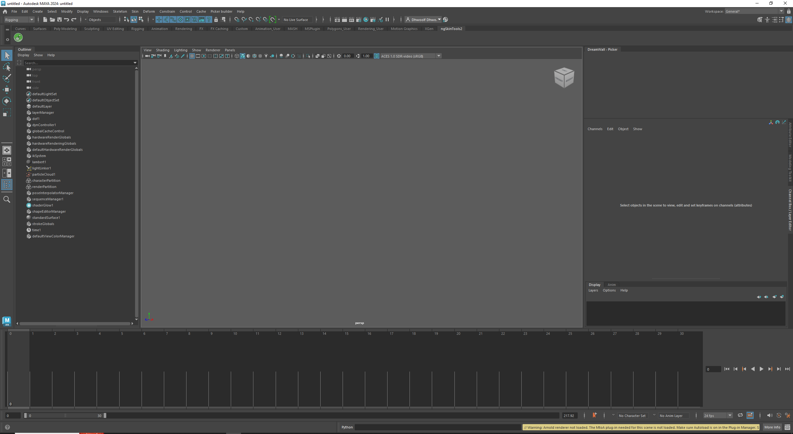

Import your character rig.

I’m using Jody from Mixamo

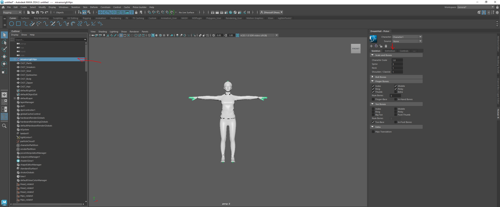

Click on the rig, and then go to definition under DreamWall Picker.

Assign bones. This should match the bones of your rig, to the labels of Maya. They may use different names (chest vs spine) that’s okay.

The Triangle allow for more bones to be assigned.

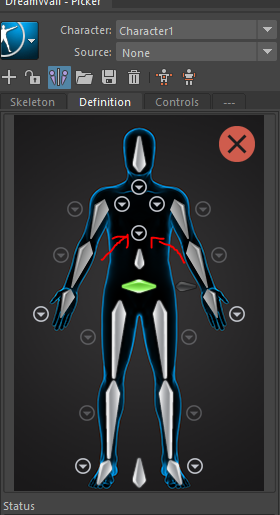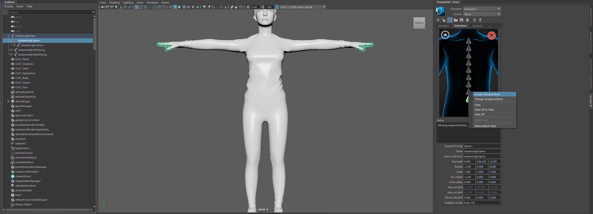

Highlight the bone from your rig, then rightclick under DreamWell and click assign.

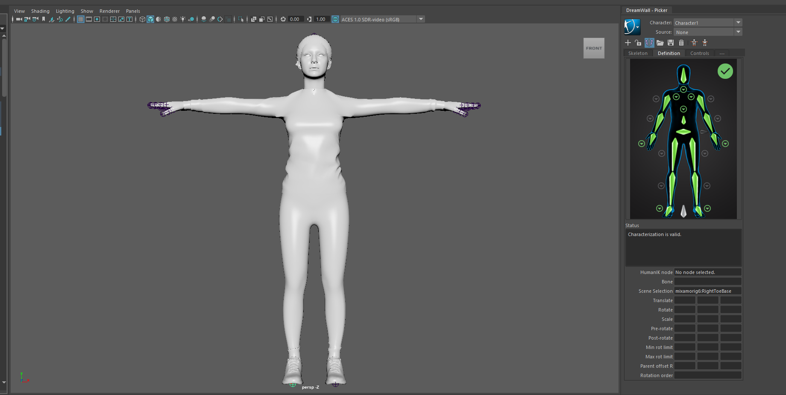

Once done you should get a green check mark.

Save your template and lock your characters.

Download the desired mocap from StudioGalt Github

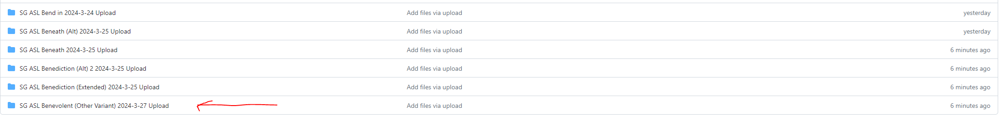

Click on desired file. We use mixamo for this example.

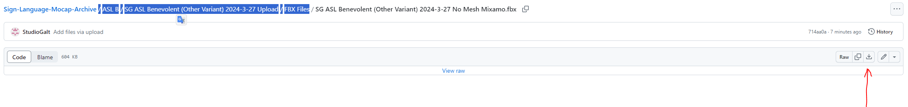

Click download.

Back in Maya

Click import 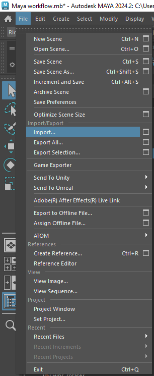. And import the recently downloaded file.

You may get a warning about different frame rates.

Our motions are recorded at 60 fps, Maya scene default is 30 fps, you can change that here.

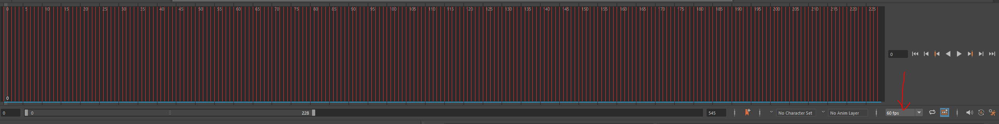

With imported motion, click the plus sign under DreamWall Picker, to create a new characterization

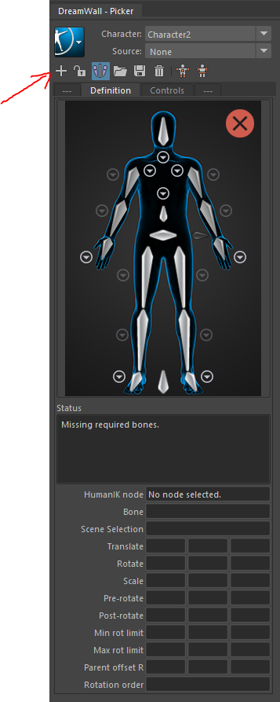

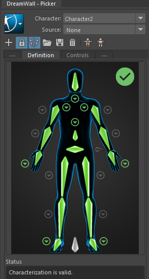

Once done lock and save!

Set Character to your rig, and Source to the Galt Motion.

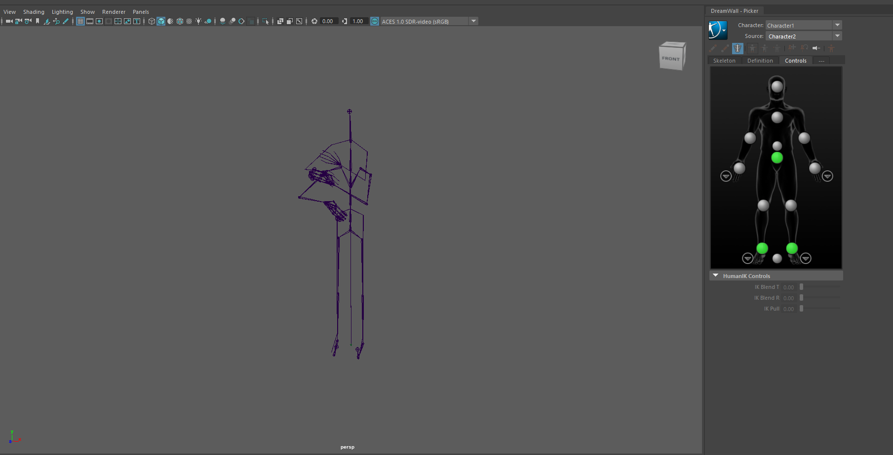

You are done!
