# Rokoko Workflow

_Converted from the original Word document in this folder._

Start with vanilla blender

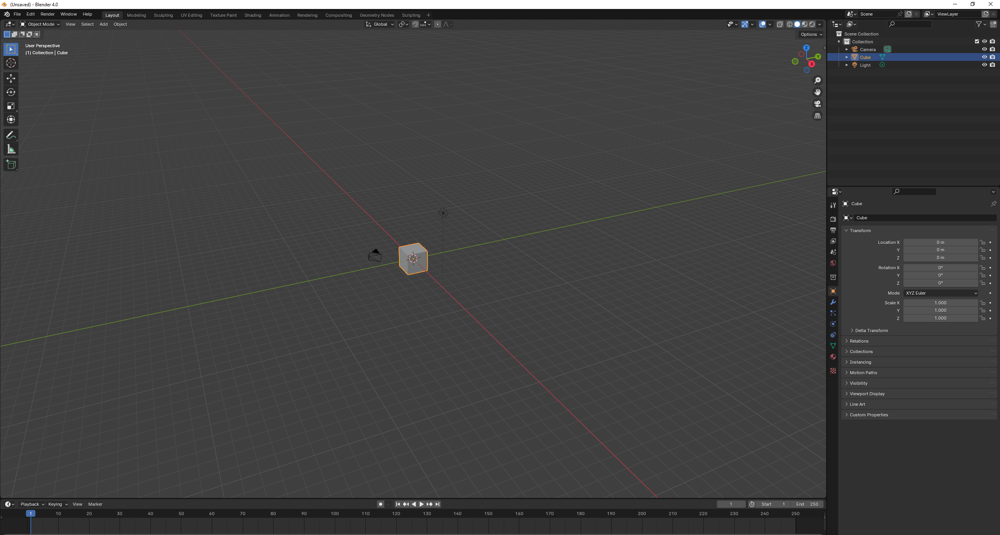

Delete the default cube to show, then click scripting workspace tab.

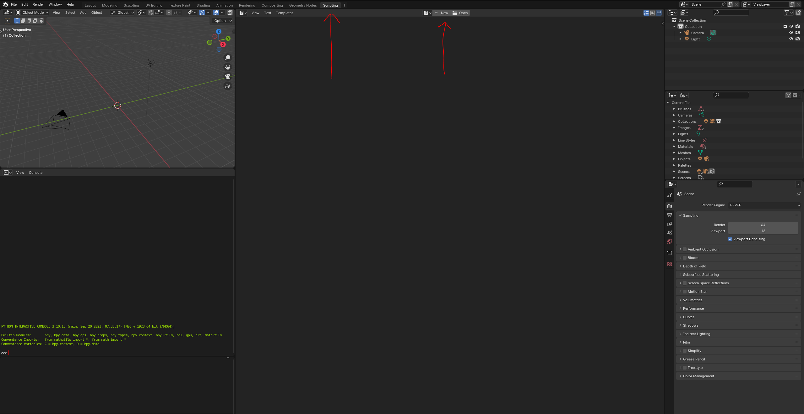

Copy the script from this link:

<https://github.com/StudioGalt/Sign-Language-Mocap-Archive/blob/main/Documentation/Scripts/1)%20Importer%20Rokoko%2030fps.py>

Paste it in the text editor.

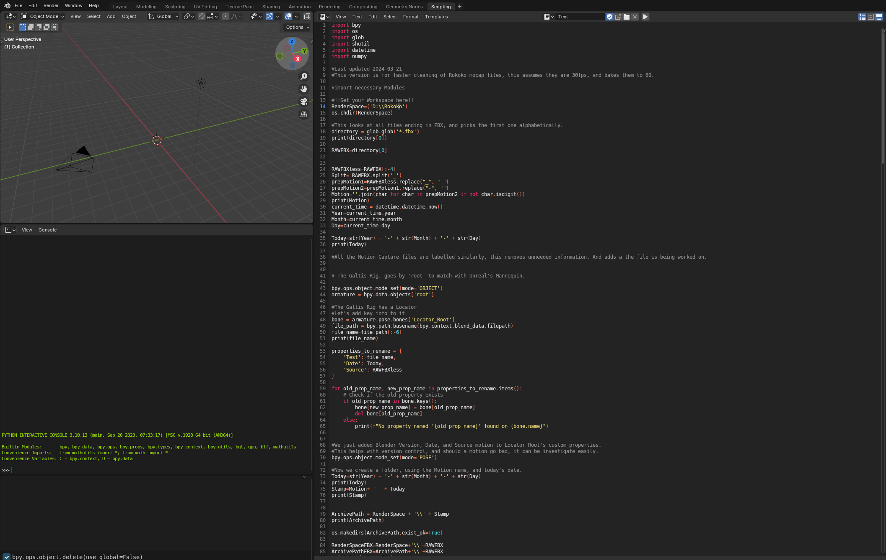

Go to line 14, and update your working directory.

I have downloaded two set of free mocap from the rokoko site.

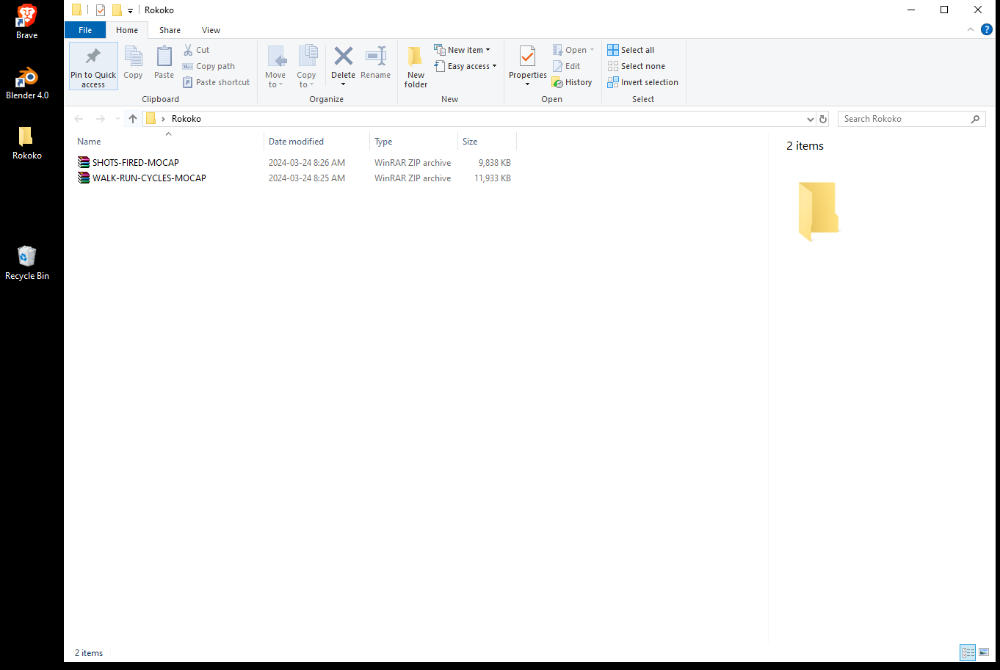

Unzip them and move them have them in working folder.

It should look something like this.

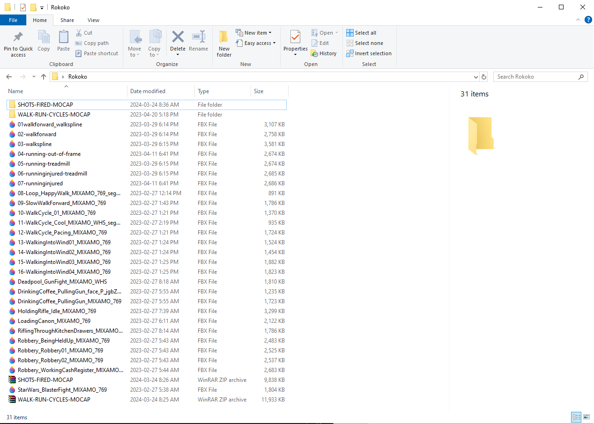

In your working folders, right click, then click on properties.

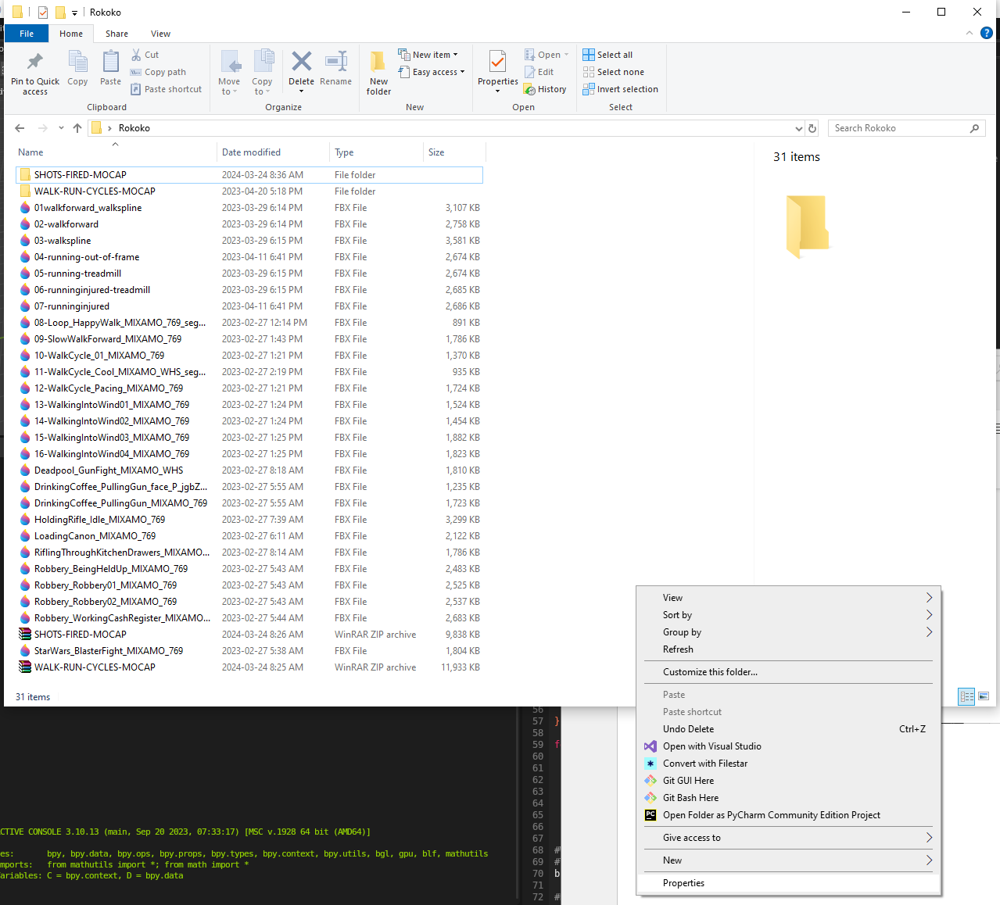

Take copy the highlighted information.

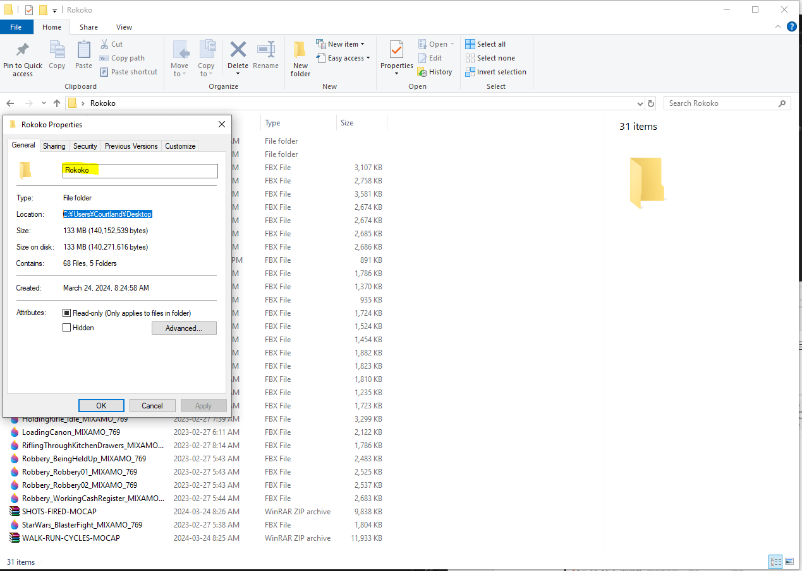

Now back in blender, make sure our working folder matches, where the script is looking, adding a double blackslash

C:\Users\Courtland\Desktop\Rokoko becomes this

RenderSpace=( C:\\Users\\Courtland\\Desktop\\Rokoko)

Now run the test script.

Expected result:

If all goes well you should have your armature imported, given a locator.

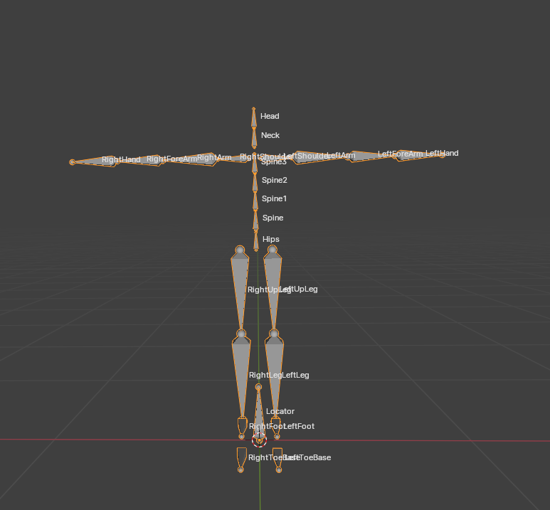

Under pose mode, the locator bone under custom properties there are some custom properties.

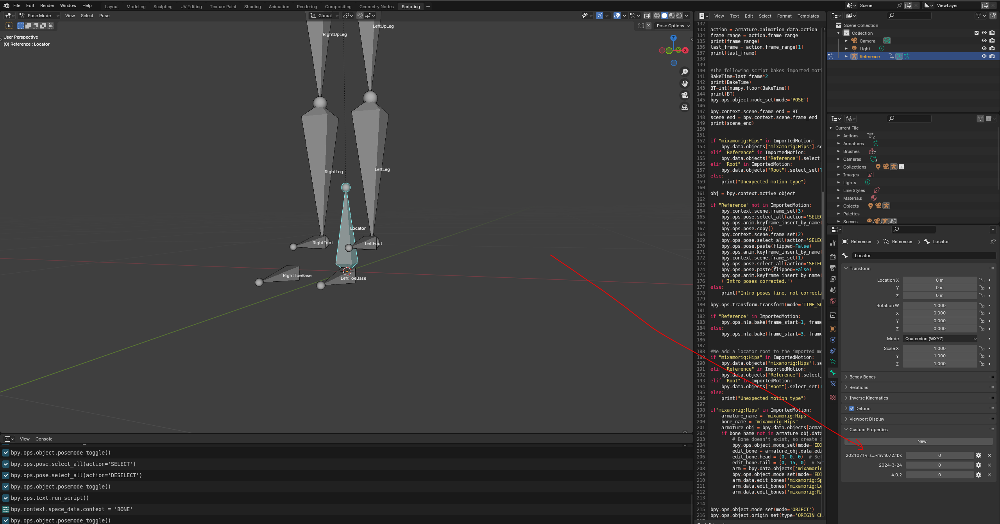

The custom properties, tell you when started the final, what is the source motion, and which version of blender you were using.

The file should be in 60 fps, as well the scene being set to 60 fps.

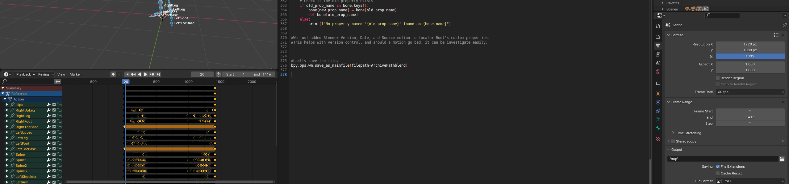

In your working folder you should have a folder matching the file name.

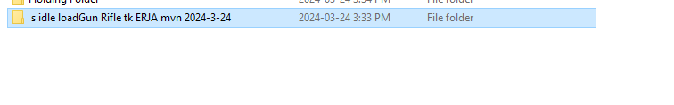

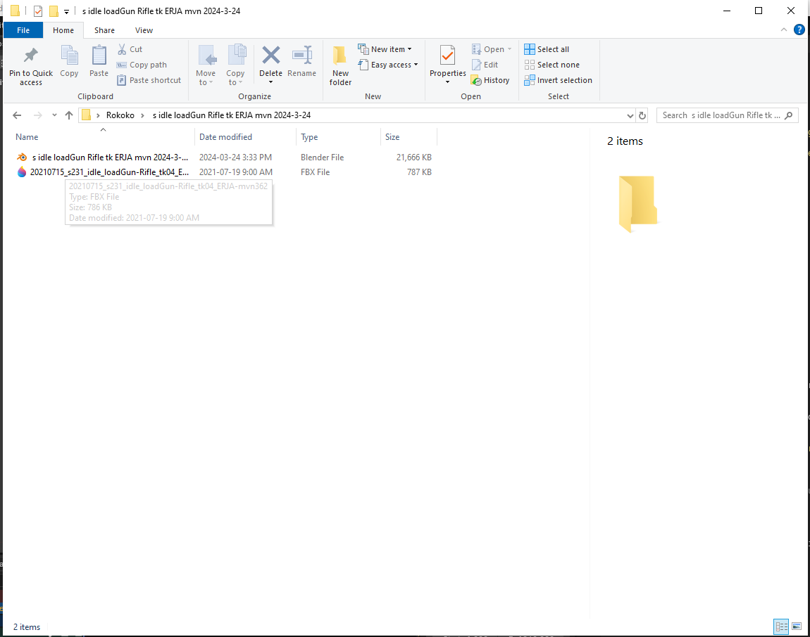

In the folder you will have your current blender file, saved to match the file name, and original file.
