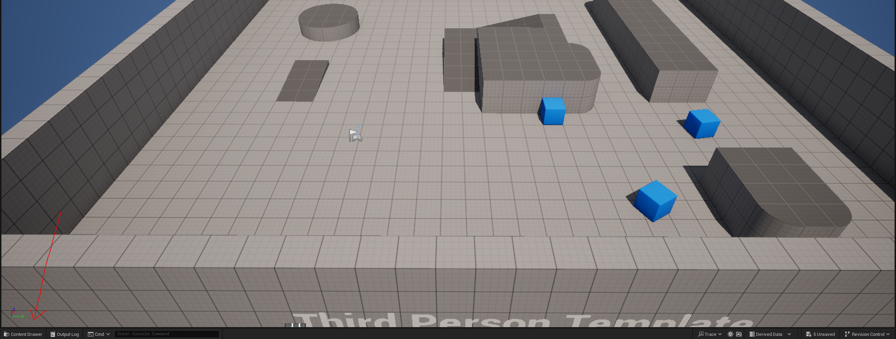
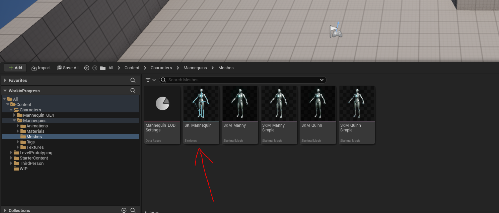
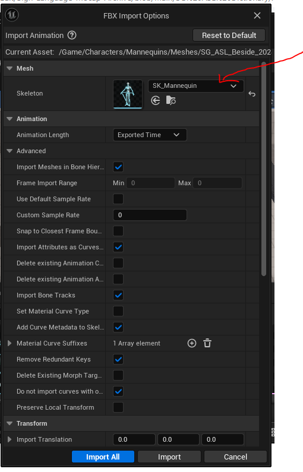
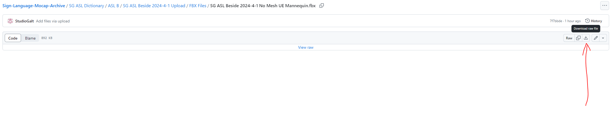
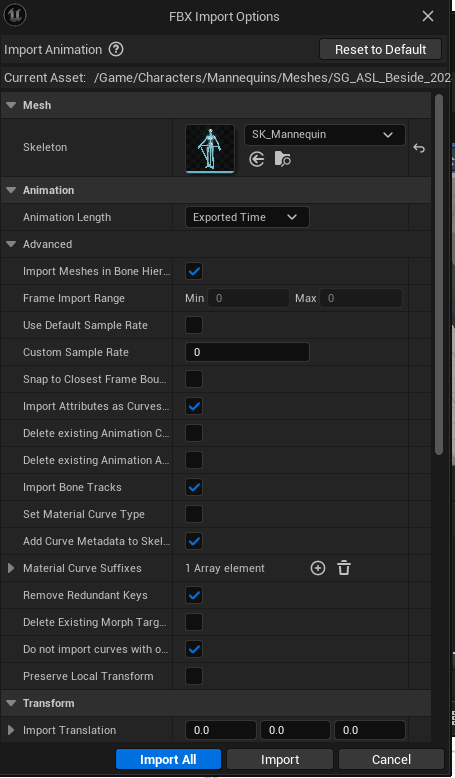
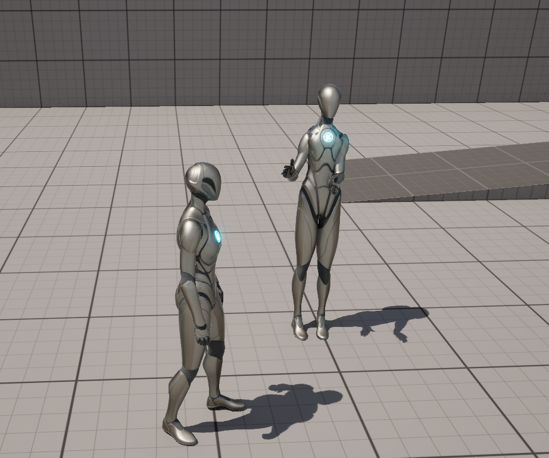

# Unreal Mannequin Workflow

_Converted from the original Word document in this folder._

Completed 2024-04-02

Tested Unreal version 5.3.2

Open your unreal engine project.

Go to content browser.

Go to Content-Characters-Mannequins-Meshes, and select the SK-Mannequins

Drag the downloaded file into Unreal Engine.

Make sure the SK_Mannequin is selected.

Download a motion from Studio Galt Github, and find a motion you wish to download.

I recommend the mannequin line.

Then Drag the downloaded file into unreal. Ensure Sk_Mannequin is selected as the skeleton. Then click select all.

Drag the created animation into your project.

You are now done.

