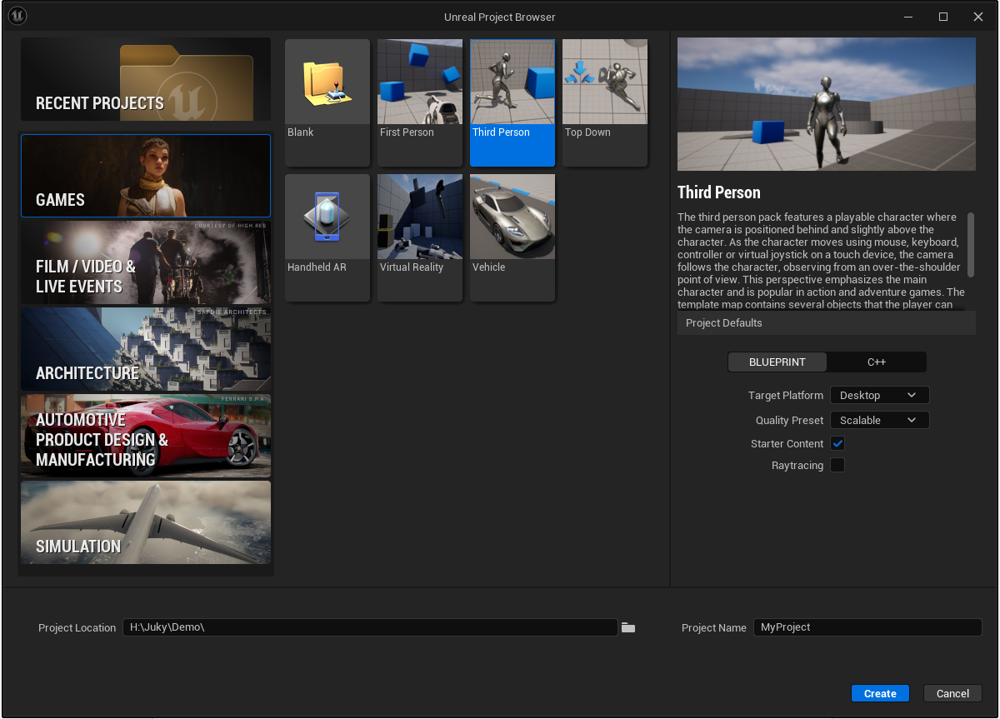
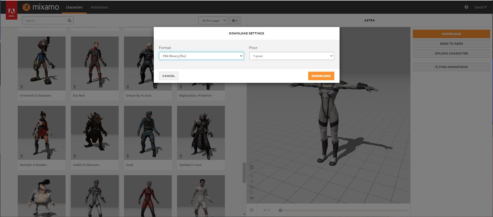
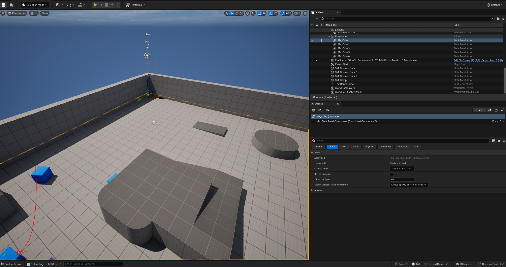
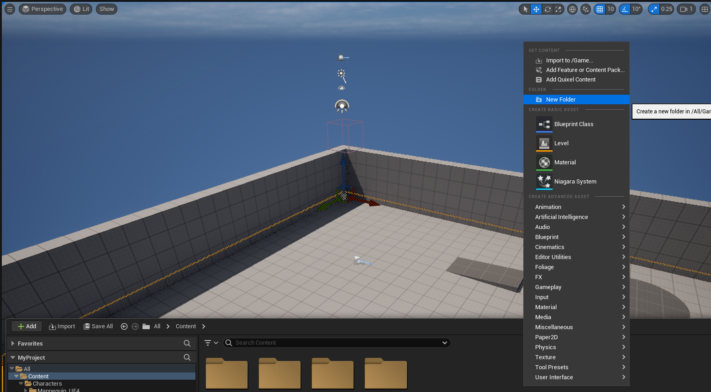
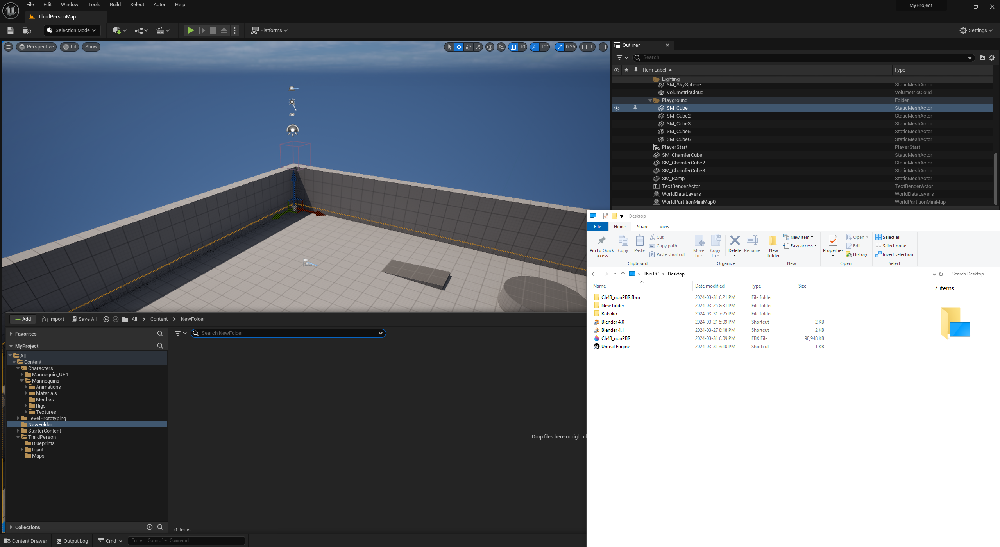
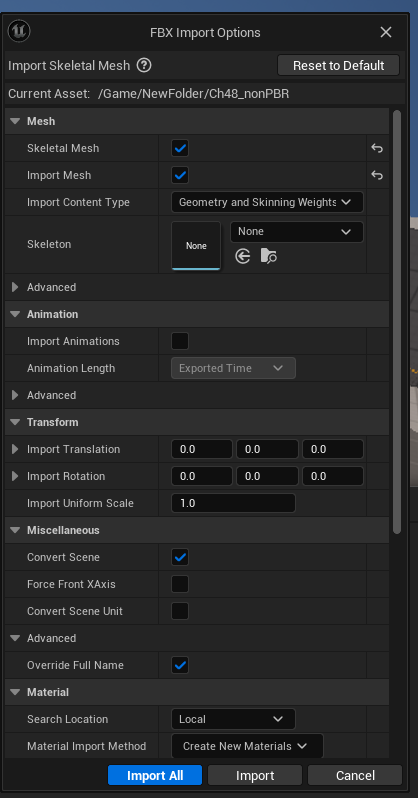
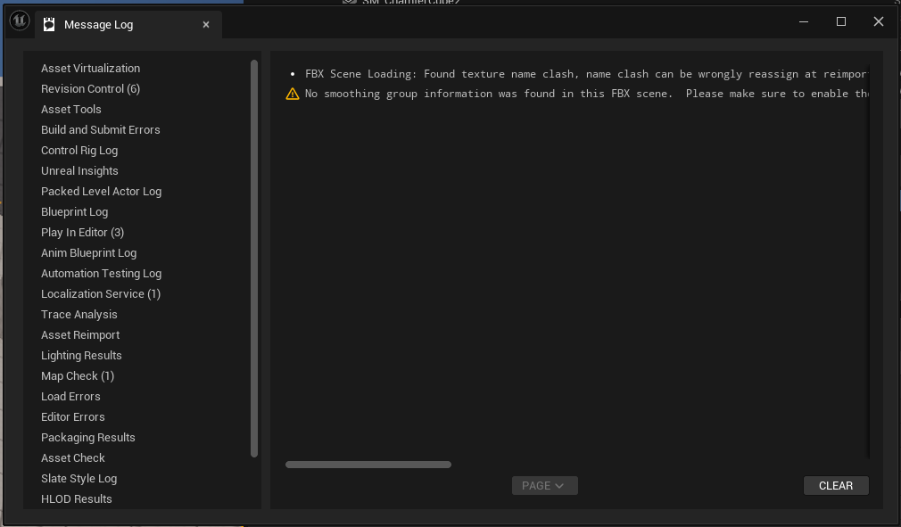
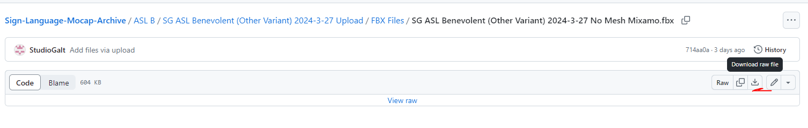
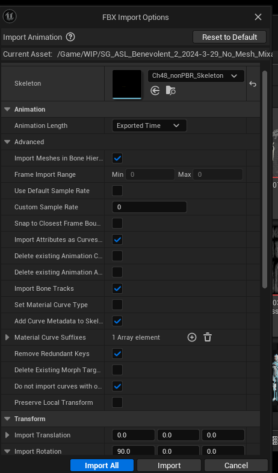
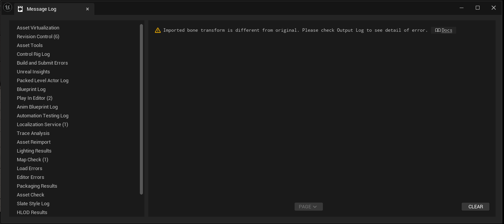

# Unreal Workflow Mixamo

_Converted from the original Word document in this folder._

Completed on March 31st,

Unreal Version: 5.3.2

Open Unreal Engine, and create a new project. I am choosing third person.

For this example we will be using a character from Mixamo.com, Download the character in T-Pose.

In unreal open the content browser.

I recommend creating a folder whether you starting a new project.

Right click in the content browser, to bring up a menu, then select create new folder.

Drag the download character into content browser.

Import all

Ignored Warning

This auto generates an unreal skeleton.

Grab a mixamo animation from Studio Galt Github.

Drag the motion into content browser.

Ensure the skeleton matches your character.

And set the rotation to 90. Unreal and Blender use different axis, the will ensure the animation has the character standing on their legs.

You will get a warning.

Hit clear and you’re done!
